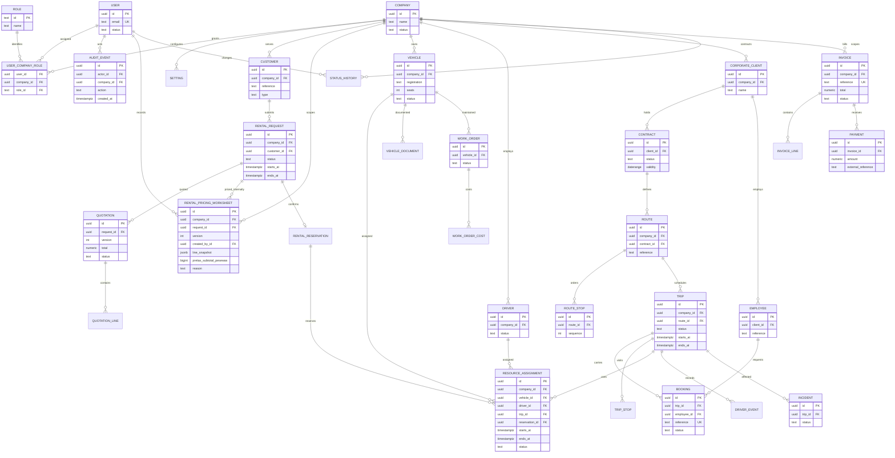

# Relational data model (target; Phase 0)

The following is the intended complete domain relationship map. Fields are abbreviated to keep the diagram legible; every tenant-owned entity carries `company_id` where applicable, with restrictive foreign keys and tenant-aware uniqueness. Global super-admin identity and system settings are exceptions. This diagram remains a target; auth/settings and the first Vehicle register schema are implemented in Prisma, but most shown domain entities do not yet exist.

## Relationships and integrity
- Company owns operational records; employee is tied to a corporate client; contract scopes routes and service; trips instantiate route/schedule; bookings connect employees to trips; rental requests connect customers to quotations and (on confirmation) reservation; assignments can connect either trip or reservation to vehicle/driver.
- `USER_COMPANY_ROLE`: unique `(user_id, company_id, role_id)`; no user-editable role grant.
- Company references: unique `(company_id, reference)` for human references; registration unique per company where policy requires; employee reference unique `(client_id, reference)`; booking unique on configured journey identity; route stop unique `(route_id, sequence)`; quotation unique `(request_id, version)`.
- Resource assignments: check `starts_at < ends_at`; active assignments require a vehicle or driver; exclude overlapping active ranges separately for `vehicle_id` and `driver_id` using GiST equality plus `tstzrange(starts_at, ends_at) WITH &&`, partial to reserved/assigned/active statuses. Constraint creation belongs to raw SQL migrations and requires `btree_gist`.
- Capacity is transactional (trip row `FOR UPDATE`) and calculated against confirmed/active passenger bookings; database consistency test required.
- Payment `external_reference` unique when present; invoice billable-event key unique to prevent double billing; invoice/payment immutable after posting.
- Cross-company foreign-key consistency must be enforced (composite tenant keys or equivalent scoped constraints) to prevent accidental cross-tenant relationships.
- Audit/status history append-only; indexes on tenant+status, tenant+created time, operational date windows, foreign keys, and normalized search keys.

The initial Prisma migration is intentionally empty apart from the extension, because Phase 0 authorizes no domain feature schema.

## Implemented additions — vehicle and driver register bases (FLT-01/FLT-04 in progress)

`Vehicle` is tenant-scoped with restrictive `Company` FK, company-unique normalized registration number, free-text company-supplied category/fuel/ownership values, optional seat count, optional odometer value paired with explicit `KM`/`MILE` unit, insurance/roadworthiness/registration expiry dates, next service date, notes, and archive timestamps. SQL checks enforce non-empty identity fields, positive seat counts, and paired non-negative odometer data. `Driver` is company-scoped with only the brief-listed licence, qualification, availability and status fields plus a name for record identity; no driver contact fields or defaults are stored.

`Vehicle.usualDriver` is optional and is constrained by a composite foreign key to a driver in the same company. An additional check keeps the relation's tenant key equal to the vehicle's company. The UI/API only expose this relation to users who can manage both fleet and driver records; assignment requires an active same-company driver. A pre-existing link to an archived driver can be preserved or cleared, but new links to archived drivers are rejected. Vehicle status, photo/document files and records remain unimplemented; see `docs/PROGRESS.md`.

## Implemented addition — non-safety maintenance work-order intake (MNT-01 partial)

`MaintenanceWorkOrder` is tenant- and vehicle-scoped with restrictive foreign keys, a tenant-unique generated reference, required fault and reason, explicit report date, optional free-text work type/priority, optional unit-paired odometer value, and initial `Reported` status. The intake accepts only explicitly non-safety reports. D-046 adds the bounded reason-audited lifecycle; approval details, completion inspection evidence and optional explicit pesewa costs are stored on the work order. No assignment, safety-block release linkage, independent inspection verification or vehicle status is added.

`MaintenanceWorkOrderStatusHistory` is an append-only, tenant-scoped transition ledger with a monotonically increasing per-work-order sequence, actor, from/to statuses, reason and timestamp. Database constraints enforce the fixed D-046 graph, initial Reported event, sequential chain, immutable rows and equality between current status and the latest history event. Every service transition also writes a transactional audit event.

## Implemented addition — vehicle safety blocks (MNT-02 partial)

`VehicleSafetyBlock` records one manager-applied safety block per vehicle, with one of the three D-016 status labels, reason, actor and timestamp. A partial unique index allows at most one unreleased block per vehicle. Restrictive company/vehicle/user foreign keys preserve tenant integrity. Applied fields are immutable; a database trigger permits only one update to release fields, which must include work completion, inspection results and a passed-inspection assertion. Vehicles with an active block cannot be archived. Fleet projections expose the active block identifier/status/time; only full fleet-manager projections include the reason. No manual status value is stored on `Vehicle`; blocks do not yet participate in assignment enforcement because assignment workflows are not implemented.

## Implemented addition — internal rental pricing worksheets (RNT-04 partial)

`RentalPricingWorksheet` is a tenant-scoped, request-scoped immutable snapshot. `(companyId, requestId, version)` is unique; rows store model/rate/quantity line snapshots as JSON, a pre-tax subtotal in pesewas, optional distance/duration quantities, creator, reason and timestamp. Foreign keys constrain company, request and user. Database checks enforce positive versions/quantities, non-negative subtotal and a non-empty reason; a trigger rejects all updates/deletes. Creation is transactionally serialized by locking the Under Review rental request. These worksheets are internal calculations only, not quotations or customer-visible financial documents.
